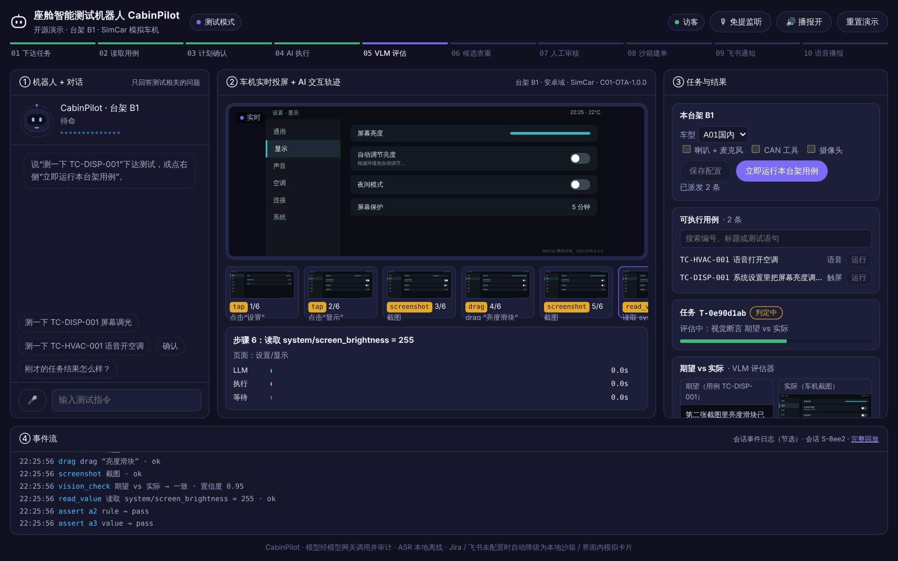

# CabinPilot 座舱智能测试机器人

**[English](#english)** · [▶ 交互演示](https://feihuiwu2022.github.io/cabin-test-agent/demo/) · [介绍页](https://feihuiwu2022.github.io/cabin-test-agent/) · [架构](docs/ARCHITECTURE.md)

用一句话下达座舱测试任务，自动完成“读用例 → 在车机上执行 → 视觉 / 语音判定 → 提缺陷 → 报告”。
另有一条用例生产线：PRD（Markdown / Word / 飞书文档）→ 需求抽取 → 用例生成与 AI 自检 → 人工审核入库 → 自动生成测试代码并在台架上首次试跑。



> 演示车型 A01 / B01 / C01 / D01 / E01 都是虚构的，不对应任何真实车辆。

## 架构



## 能做什么

| 场景 | 说明 |
|---|---|
| 下达测试 | 打开就是测试模式；打字、按住说话或免提（唤醒词“你好小禾” / “hello xiaohe”）；助手只回答测试相关的问题，下达任务前要确认计划 |
| 执行用例 | 触屏用例（多级控件定位、拖动滑块等）和语音用例（合成测试音频、唤醒、收听播报）；视觉模型 + 规则 + 车辆属性三类判定 |
| 缺陷 | 失败自动查重，生成缺陷候选，人工审核后建 Jira 单（没配 Jira 时用本地沙箱） |
| 用例生产 | PRD 版本与增量、按模块的“用例编写规范包”（网页编辑、试生成对比、按驳回原因建议规则） |
| 台架 | 每台台架 PC 一个 Agent（可打包成 Windows exe），离线补传；没有真机时用内置 SimCar 模拟车机 |

## 在线演示

- **[交互演示](https://feihuiwu2022.github.io/cabin-test-agent/demo/)**：真实的演示主页，回放一次在 SimCar 模拟车机上的真实运行（系统设置调光、语音开启空调两条用例），不连服务器，打开就能点。
- **自己跑完整版**：公开演示镜像（仓库根目录 `Dockerfile`）带访客模式、只读配置和每日调用上限，部署方法见 [deploy/README.md](deploy/README.md)。模型密钥只放在服务器环境变量里。

## 快速开始（本地）

需要 Python 3.12、[uv](https://docs.astral.sh/uv/)、Node 22。

```bash
uv sync --all-packages
```

```bash
cp .env.example .env
```

在 `.env` 里填 `CABIN_LLM_API_KEY`（默认用 MiniMax 的 Anthropic 兼容接口，也可以换成其它兼容接口），然后用 Docker 一键跑演示：

```bash
docker build -t cabinpilot-demo . && docker run --env-file .env -p 7860:7860 cabinpilot-demo
```

打开 http://127.0.0.1:7860 。不用 Docker 的分步运行见下文“运行”。

## 结构

```
packages/common/   cabin_common：云端和台架共用的模型、TaskPlan 规范、结果与判定请求
apps/cloud/        cabin_cloud：用例库、测试代码、台架管理、任务池、判定、登录、调度看板（独立部署）
apps/agent/        cabin_agent：执行闭环、离线补传、本地页面与投屏（每台台架 PC 一份）
tests/integration/ 云端和台架联合测试
```

详见 [docs/ARCHITECTURE.md](docs/ARCHITECTURE.md)，定案设计见 [docs/CLOUD_AGENT_DESIGN.md](docs/CLOUD_AGENT_DESIGN.md)。

## 运行

```bash
uv sync --all-packages
```

```bash
cd apps/cloud/web && npm ci && npm run build
```

```bash
cd apps/agent/web && npm ci && npm run build
```

云端（默认 :8800）。本地调试不接飞书时设 `CABIN_AUTH_MODE=dev`；`CABIN_RIG_REGISTER_CODE` 要设置，否则台架注册不上：

```bash
uv run cabin-cloud
```

台架 Agent（本地页面 :8810），配置见 [apps/agent/README.md](apps/agent/README.md)：

```bash
uv run cabin-agent
```

- 云端 http://云端:8800/cases：对话生成用例、审核入库、测试代码；/board：台架状态、执行情况。
- 台架本地 http://127.0.0.1:8810：下发测试、实时投屏。本地页面带登录身份代理到云端。

没有真机时设 `CABIN_DEVICE=simcar`，用内置模拟车机（含两个已知缺陷）。

模型凭证只在云端 `.env`（`CABIN_LLM_API_KEY / CABIN_LLM_BASE_URL`），不进前端、不写日志，也不下发到台架。
语音识别模型（SenseVoice，约 230MB）放在 `apps/cloud/models/`，没有时只是不能语音输入：

```bash
mkdir -p apps/cloud/models && curl -fsSL https://github.com/k2-fsa/sherpa-onnx/releases/download/asr-models/sherpa-onnx-sense-voice-zh-en-ja-ko-yue-2024-07-17.tar.bz2 | tar -xj -C apps/cloud/models
```

云端运行期数据（SQLite `apps/cloud/data/cabin.sqlite3`、证据 `apps/cloud/data/evidence/`）不入库，
启动时自动重建：表结构由 `CREATE TABLE IF NOT EXISTS` 创建，Jira 种子（A01-51234）写在代码里。
入库的只有用例种子：`apps/cloud/data/cases/`。

## 演示话术

| 步骤 | 说 / 点 |
|---|---|
| 运行用例 | 右栏“立即运行本台架用例”，或在“可执行用例”里点运行 |
| 语音下达 | “在 B2 台架测一下显示设置的亮度页” |
| 计划确认 | 说 “确认” 或点计划卡片上的确认 |
| 人工审核 | 说 “确认是缺陷” / “关联已有单” / “驳回，判定误报”，或点右栏按钮 |
| 状态问答 | “刚才的任务结果怎么样？” |

另一条用例 “测一下声音设置的音效” 演示崩溃规则判定（J-02，logcat FATAL EXCEPTION）。

语音：顶栏「免提监听」开启浏览器端 VAD 自动切句，播报中说话可打断；「唤醒词：你好小禾」开启后需以“你好小禾”或“hello xiaohe”开头，30 秒内连续对话免唤醒。也可按住麦克风按钮说话，或直接打字。

## 用例闭环（一期 A：PRD → 用例 → 审核 → 入库 → 拉取 → 测试代码）

在云端用例工作台（/cases）的对话框里给出 PRD，三种方式任选：

| 方式 | 示例 |
|---|---|
| 上传本地文件 | 点输入框旁 📎（或拖入），支持 .docx / .pdf / .md / .txt，可补一句“只生成 §4.1” |
| 本机路径 | `把 D:\docs\语音助手PRD.docx 的 §4.1 转成测试用例` |
| 在线链接 | `https://xxx.feishu.cn/docx/…… 生成用例`（飞书需配 `FEISHU_APP_ID/SECRET`，并把应用加为文档协作者）；普通网页 / 文件直链直接读取 |

流程（界面 ② 用例工作台 + 顶部 8 步轨道）：
1. **需求提取**：需求点 REQ-nn（带来源章节与原文）+ 待确认项（不生成用例，审核后转需求方）。
2. **用例生成 + AI 自检**：每条用例字段按云端 test_case；语音用例带测试语句、期望屏幕、期望播报、时延、音色。自检标出重复、缺前置条件、预期不可判定、通道不符、PRD 未定义。
3. **用例审核（人工门）**：逐条通过 / 修改后通过（就地改字段）/ 驳回（必选原因，写入评估集）/ 转需求方；未审核完不能提交，未审核的不入库。也可说“采纳建议并提交审核”。
4. **入库通知**：审核通过的写入用例库，飞书群卡片（未配置 Webhook 时界面内模拟）。入库用例同时可被测试闭环 `read_case` 读到。
   - 配置了飞书多维表格（见下）时，表格是用例主数据：批次生成完即以“待审核”写入表格（表格也是审核入口，可直接改“审核状态”列）；CabinPilot 审核台的结论、自动化状态同样回写。表格里的修改每 5 分钟（或点“从多维表格同步”）同步回 CabinPilot，以表格为准并记录变更历史；步骤 / 预期 / 通道 / 测试语句等变化时测试代码置为“需重新生成”；同步时校验必填、单选取值、用例编号唯一，不合格的行不入库并在界面列出。列不存在会自动创建。
   - 未配置时用例库落本地（`apps/cloud/data/cabin.sqlite3`）。
   - 首次配置：在 `.env` 填 `FEISHU_APP_ID` / `FEISHU_APP_SECRET`，运行 `uv run python scripts/setup_bitable.py`，由应用建表并写入 `FEISHU_BITABLE_URL`。应用建的表归应用所有，开放链接需要云文档权限设置类权限，且权限开通后要发布应用版本；也可以自己建表、把应用加为协作者，再用 `--url` 指定。
   - 在对话里说“同步多维表格”可立即读回。
5. **用例拉取**：说“拉取 C01 用例”，或台架调接口 A-15 `GET /api/v1/cases?model=C01`；只返回审核通过的，尚无测试代码的触发生成。
6. **测试代码**：生成 TaskPlan（cabin/taskplan/v1，YAML）——语音用例走固定时序模板，触屏用例由模型翻译成动作库动作（失败时规则兜底）；静态校验（动作库、参数、通道一致、断言判定方式、红线、CAN / shell 白名单）不通过则 `invalid`。代码存 `apps/cloud/data/plans/`（独立 git 仓库，提交号即 plan_version），`GET /api/v1/plans/{case_id}` 下载；界面可“抽查通过”置为已验证。

示例 PRD：`apps/cloud/data/samples/语音助手_空调控制_PRD.md`（快捷指令“导入示例 PRD 生成用例”）。

## 配置（环境变量，可选）

| 变量 | 作用 | 不配置时 |
|---|---|---|
| `CABIN_AUTH_MODE` `CABIN_DEV_USER` | 登录方式：feishu / dev（dev 只用于本地调试） | feishu |
| `CABIN_RIG_REGISTER_CODE` | 台架注册码 | 拒绝新台架注册 |
| `JIRA_URL` `JIRA_USER` `JIRA_PASSWORD` `JIRA_PROJECT` | Jira 沙箱 REST 查重/建单 | 本地 Jira 沙箱（SQLite，含已知缺陷种子 A01-51234） |
| `FEISHU_WEBHOOK` | 飞书群机器人卡片 | 界面内模拟卡片 |
| `FEISHU_APP_ID` `FEISHU_APP_SECRET` `FEISHU_CASE_DOC` | 读飞书云文档用例 | 本地用例缓存 `apps/cloud/data/cases/*.yaml` |
| `FEISHU_APP_ID` `FEISHU_APP_SECRET` `FEISHU_BITABLE_URL` | 用例库写入飞书多维表格并双向同步（应用需开通多维表格读写权限，并在表格中加为可编辑协作者） | 本地用例库 |
| `CABIN_BITABLE_SYNC_S` | 多维表格 → CabinPilot 同步周期（秒） | 300 |
| `CABIN_CHAT_MODEL` `CABIN_VISION_MODEL` | 模型 | MiniMax-M3 |
| `CABIN_VERSION_LABEL` | 右上角顶栏版本标识 | 开源演示 |
| `CABIN_STRICT_DATA=1` | 内部/敏感数据禁止走外网模型 | 关闭（开发期，审计里标 DEV-ONLY） |

## 自验证脚本

```bash
uv run pytest -q
```

用例闭环（真实模型，云端需已启动，`CABIN_E2E_TOKEN` 填登录令牌）：

```bash
uv run python apps/cloud/scripts/casegen_e2e.py
```

可带参数指定 PRD：`uv run python apps/cloud/scripts/casegen_e2e.py "把 D:\docs\x.docx 的 §3.2 转成测试用例"`。

对全部 TaskPlan 干跑，不操作车机：

```bash
uv run python apps/cloud/scripts/plan_dry_run.py
```

真机亮度用例（只验操作结果，用 adb 严格校验系统值）：

```bash
uv run python apps/agent/scripts/brightness_e2e.py
```

语音用例的测试音频在生成 TaskPlan 时合成，缓存在 `apps/cloud/data/assets/`，同一句话不重复合成，台架回放前按哈希下载。

对话里说“在 B2 台架测一下 TC-DISP-017”：用例已有测试代码时回放测试代码，要先确认计划。AI 探索尚未迁移到台架 Agent，没有测试代码的用例暂时不能执行。

另有配置脚本 `apps/cloud/scripts/setup_env.py`（生成 / 校验 `.env`，见「首次配置」）。

---

## English

**CabinPilot** is a voice-driven test robot for automotive infotainment (IVI) systems.

- **Test mode, straight away** — open the page and give a test task in one sentence, by text, push-to-talk or hands-free (wake word *"hello xiaohe"* / “你好小禾”). The assistant only answers testing questions. The robot reads the test case, replays its test code on the head unit (touch actions over ADB, or synthesized voice commands), judges the result with a vision model + rules + vehicle properties (VHAL), dedups failures into defect candidates, and files Jira tickets after human review.
- **Case pipeline** — PRD (Markdown / Word / Feishu docs) → requirement extraction → LLM case generation with self-check → human review → auto-generated test code → first trial run on a rig. Per-module "skill packs" (editable in the web UI, git-versioned) tune how cases are written.
- **Rig agent** — one per test PC (packaged as a Windows exe), with offline upload; a built-in browser-based **SimCar** head unit is used when no real device is attached.

Stack: FastAPI, React + Vite, Anthropic-compatible LLM API (MiniMax by default), sherpa-onnx SenseVoice (offline ASR), Playwright (SimCar).

Try the [interactive demo](https://feihuiwu2022.github.io/cabin-test-agent/demo/) (a replay of a real run, no server needed), or run it locally: put `CABIN_LLM_API_KEY` in `.env`, then

```bash
docker build -t cabinpilot-demo . && docker run --env-file .env -p 7860:7860 cabinpilot-demo
```

The demo vehicle models (A01 / B01 / C01 …) are fictional. Licensed under MIT.
