# CabinPilot 实现架构



本文写 CabinPilot 的实现架构，以及各外部依赖在开源演示版里的替代方案。
用例执行层（TaskPlan Runner、动作通道、证据、评估器）见 [EXECUTION_ARCHITECTURE.md](EXECUTION_ARCHITECTURE.md)，R0、R1 已实现。
下文 4.4 的 TaskPlan 指 AI 探索任务，代码中已改名 `ExploreTask`；`cabin/taskplan/v1` 现在专指测试代码 YAML。

## 1. 目标闭环

打开台架页面即测试模式 → 语音或打字下达测试 →
读用例取期望 → 计划复述 + 确认（confirm_gate）→ AI 探索执行（VLM 看图决策，投屏 + 轨迹）→
评估器（规则 + VLM 期望 vs 实际）→ 指纹查重 → 人工审核（review_gate）→ Jira 沙箱建单 →
飞书通知 → 语音播报。

## 2. 运行环境与外部依赖取舍

| 原设计依赖 | 本次实现 | 说明 |
|---|---|---|
| 内网 Qwen（LLM/VLM） | MiniMax-M3（Anthropic 兼容接口），经 `modelgw` | 已实测：中文、工具调用、看图（能识别文案截断）。模型网关按数据分级打标签与审计，换内网模型只改配置 |
| 内网流式 TTS | MiniMax `t2a_v2`（speech-2.8-turbo） | 按句合成，首句先出声 |
| 内网流式 ASR | 本地 sherpa-onnx + SenseVoice（离线，中文） | MiniMax 无公开 ASR；本地离线更符合"数据不出网" |
| 唤醒 / VAD / AEC | 浏览器端：getUserMedia(echoCancellation) + 能量 VAD；唤醒词 = 识别文本匹配 | 无麦克风阵列时的软件近似 |
| 安卓台架（ADB） | `AndroidAdbAdapter`（adbutils）+ `SimCarAdapter`（模拟车机） | 当前没有连接设备，默认用 SimCar；有设备时配置切换，上层不变（P-5） |
| Jira 沙箱 | `JiraClient`：配了 REST 就走 REST（一档），否则走本地沙箱库（SQLite）+ 预填链接/草稿 | 没配置时自动降级 |
| 飞书 | Webhook 配置了就推卡片，否则界面内模拟卡片；用例读取：飞书文档 API（已配置时）/ 本地用例缓存 | 没配置时自动降级 |

## 3. 逻辑分层与模块

```
packages/common/cabin_common       云端和台架共用，不依赖数据库、模型与设备
 ├─ schema.py     数据模型          vehicles.py   车型字典
 ├─ taskplan.py   动作库 + 静态校验  results.py    回放结果与结论合成
 ├─ judging.py    判定请求（A-10）   crash.py      崩溃 / ANR 规则
 ├─ audio.py      测试音频缓存       env.py        .env 加载
 └─ images.py     图标模板缓存       uimap.py      UI 地图数据模型与 SoM 编号

apps/cloud/cabin_cloud             云端，独立部署；web/ 是调度看板、用例工作台、触屏执行（/touch）、设置（React + Vite）
 ├─ main.py       FastAPI 入口、接口保护、托管看板
 ├─ auth.py       飞书登录、会话、给本地页面的一次性票据
 ├─ board.py      看板接口：台架状态、执行情况、回归缺陷审核
 ├─ rigs.py       台架档案与在线判定
 ├─ execsvc/      service.py 任务状态机、查重、审核、建单；rigapi.py 台架接口 A-01~A-10；defects.py 缺陷候选
 ├─ gateway.py    会话、意图路由、WS 协议
 ├─ assistant/    对话 Agent：Loop、工具、Hooks、提示词
 ├─ casegen.py caselib.py casewf.py casexls.py cases.py prd.py   用例生成、审核、用例库
 ├─ planner.py planvars.py planloader.py audioasset.py           测试代码生成、车型代入、音频合成
 ├─ uimap.py heal.py imgasset.py                                UI 地图录制确认与生成、自愈建议、图标模板
 ├─ schedule.py                                                定时回归与每日飞书汇总
 ├─ judge.py judgeclient.py modelgw.py modelopenai.py voice/ integ/  判定、模型网关与 OpenAI 兼容适配、语音、Jira 与飞书
 └─ store.py      结果库（一期 SQLite）

apps/agent/cabin_agent             台架 Agent，每台 PC 一份；web/ 是本地页面（React + Vite）
 ├─ daemon.py     注册、心跳、领取、执行、补传
 ├─ client.py     云端接口客户端：包络、错误分类、退避
 ├─ outbox.py     离线缓存（SQLite 先进先出）
 ├─ judge.py      判定的 HTTP 实现（A-10）
 ├─ localweb.py   本地页面：投屏、本机状态、登录、代理到云端
 ├─ assets.py     测试音频与图标模板本地缓存
 ├─ uimap_rec.py  UI 地图录制（每步经云端选编号，录完上传待确认）
 ├─ device/       DeviceAdapter 抽象；adb.py、simcar.py
 └─ runner/       TaskPlan 执行器：引擎、动作通道、证据、评估器（设计见 EXECUTION_ARCHITECTURE.md）
```

### 云端与台架的边界

下表是**当前代码**的情况，目标设计见 [CLOUD_AGENT_DESIGN.md](CLOUD_AGENT_DESIGN.md)，两者的差别按其第 12 章分步消除。

| 能力 | 当前位置 | 目标位置 |
|---|---|---|
| 用例库、测试代码、台架管理、任务池 | 云端 | 云端 |
| 回放执行、离线补传 | 台架 Agent | 台架 Agent |
| 实时投屏、本机状态 | 本地页面 | 本地页面 |
| 台架在线状态、执行情况 | 云端看板 | 云端看板 |
| 用例生成与审核、用例对话框 | 云端 Web `/cases` | 云端 Web |
| 执行对话框 | 本地页面代理到云端 | 本地页面 |
| 车型选择、硬件声明 | 本地页面，保存后重新注册 | 本地页面 |
| 台架用例集、缺台架能力清单 | 云端看板 | 云端看板 |
| 缺陷审核与建票 | 云端看板 | 云端 Web |
| 证据 | 只传失败证据，处理后删除 | 只传失败证据，处理后删除 |

单条测试也走云端任务池，看板才看得到。本地页面只监听 127.0.0.1，并校验 Host 与 Origin，防止其他网页借本机登录身份调用云端。

### 与接口约定的差异

- A-10：图片用 multipart 随请求上传，不用 evidence 引用，这样判定不依赖证据上传顺序。
- A-01：注册码来自云端配置 `CABIN_RIG_REGISTER_CODE`，通过即启用，暂无一次性注册码与审批流程。
- PF-SAF-01：台架令牌存在数据目录的文件里（权限 600），暂未进系统凭据库。
- A-03：TaskPlan 总是内联下发，不区分 64 KB 阈值。
- 新增（原接口约定未定义）：`POST /api/v1/uimap/decide` 录制时选编号（带编号截图 → 云端多模态模型只回编号）、`POST /api/v1/uimap/recordings` 上传录制与截图（云端校验哈希，一律存为待确认）、`GET /api/v1/plans/{case_id}/images/{name}` 下载图标模板。录制选编号和 A-09 一样是台架借云端调模型，但不绑定执行单元。
- 定位失败阻塞（locator）时台架只上传失败现场 `fail-NN.png` / `fail-NN.ui.json`，供云端出自愈建议；其余阻塞不传证据。
- 租约与续约（A-04）、掉线转移放在调度阶段；当前任务只等台架回传，超时后中断。

### 尚未迁移

- AI 探索：边看屏边调模型，需要单独的协议，本轮下线，没有测试代码的用例暂时不能执行。
- 实时语音通道：ASR / TTS 仍在云端，真实音箱 + 麦克风通道未接入。
- 任务状态在云端进程内存里，云端重启后进行中的任务不再更新界面，结果照常入库；待审核候选也在内存中。

依赖只自上而下；跨包只通过 `schema.py` 的数据契约。

## 4. 关键设计

### 4.1 鉴权与对话范围
- 只有测试这一个场景：台架页面打开就是测试模式，登录用户（`authed`）才能下达测试；云端用例工作台不调台架。
- 未登录时测试工具不挂载，`pre_tool` 再拦一次。
- 助手只回答测试相关的问题（用例、任务、结果、缺陷、台架、系统用法），其他问题礼貌说明只负责测试；没有车型资料检索和联网搜索工具。

### 4.2 Agent Loop
- 薄自研循环：`anthropic` SDK 直连模型网关，流式输出；工具 Schema 由 Pydantic 模型生成。
- 偏差说明：PRD 基线是 Pydantic AI；MiniMax 返回 thinking 块等兼容细节在薄 SDK 层更好控制，框架层可后续替换，不影响上层。
- 回复文本流按句切分 → TTS 队列 → `reply.audio` 下发；被打断（`barge_in`）时取消本回合。

### 4.3 工具与人工门
| 工具 | 谁能用 | 门 |
|---|---|---|
| read_case | 登录用户 | — |
| plan_task | 登录用户 | **confirm_gate**：生成 TaskPlan，校验后挂起为"待确认"，由网关等用户确认（按钮或语音"确认"） |
| cancel_task | 登录用户 | confirm_gate |
| query_status | 登录用户 | — |
| file_bug | 系统内部（审核通过后） | **review_gate**：未审核不建单 |
| notify | 系统内部 | — |

确认与审核由网关/服务直接处理，不由模型判断；模型漏掉确认，Hook 也拦得住。

### 4.4 TaskPlan 与执行
- `TaskPlan`（schema `cabin/taskplan/v1`）字段与 PRD 一致：origin / case_ref / target / steps / judge / report / limits。
- 校验：台架存在于档案；包名在白名单；ai_explore 必须有期望；step.type ∈ {ai_explore, replay}；红线操作（刷机/恢复出厂/清数据）拒绝。
- 状态机：草稿 → 待确认 → 排队 → 准备 → 执行中 → 判定中 → 已完成 / 已取消 / 环境异常 / 执行中断。
- 调度：每台架一把锁（台架独占），健康检查（在线、读 OTA 版本、包已安装）。
- AI 探索：每步 截图 + 控件列表（带编号）→ VLM 返回 `{thought, action, element_id|x,y, done}` → 执行 → 记录步骤（截图、动作、LLM/执行/等待耗时）。产物固化为回放脚本（按控件文本定位），供兜底回放（`replay` 不调模型，P-1）。
- 证据：每步截图、logcat 增量、版本信息，存 `data/evidence/<task>/`。

### 4.5 评估与缺陷闭环
- 规则：J-02 `FATAL EXCEPTION` 属被测包、J-03 `ANR in <pkg>` → 置信度高。
- VLM：期望（用例预期结果）+ 最终截图 + 控件列表 → `{consistent, diff_summary, reason, confidence, element_id}`，element_id 用于在实际截图上画红框。
- 置信度分级：规则=高；VLM≥0.8=中（AI 判定）；其余=低。
- 指纹：`类型|包名|页面|用例ID`（崩溃取栈顶 3 帧）。查重按 OTA 版本分类（同版本未关闭=疑似重复；旧版本未关闭=老问题延续；旧版本已关闭=回归；未命中=新缺陷）。
- 审核：确认（可改严重度/摘要）→ 建单；关联已有单 → 追加评论；驳回 → 必选原因，写入评估集。结论写结果库，同版本同指纹再现：已驳回压掉计数、已确认自动关联。

### 4.6 事件日志
SQLite 追加写：`turn.start/end, user.message, context.inject, model.request/response, tool.call/result, confirm.request/response, review.*, task.*, assistant.message`。`GET /api/sessions/{id}/events` 回放。

### 4.7 WebSocket 协议
上行：`session.open, user.text, barge_in, confirm.response, review.action, mode.set`
下行：`session.state, asr.final, reply.text(delta/final), reply.audio, confirm.request, task.event, task.step, screen.frame, defect.card, jira.result, feishu.result, log`
音频：浏览器 VAD 切段 → `POST /api/asr`（16k WAV）→ 文本 → `user.text`。

## 5. 数据分级与安全
- 模型网关给每次调用打 `data_label ∈ {public, internal, sensitive}` 并审计（event log）。
- 当前只有外网 MiniMax 一个后端：`internal/sensitive` 调用会在审计里标记 `route=external(DEV-ONLY)`；配置 `CABIN_STRICT_DATA=1` 时直接拒绝这类调用（接入内网模型后打开）。
- 密钥只从本地 `.env` / 环境变量读，不进前端、不进日志；`.env` 由 `.gitignore` 排除，仓库只保留 `.env.example` 模板。
- 首次配置用 `apps/cloud/scripts/setup_env.py`（生成 `.env`，权限 600）；`--check` 会实际调用模型网关验证 token 有效。

## 6. 部署

云端：`apps/cloud/Dockerfile`，或 `uv run cabin-cloud`（默认 :8800，同时托管调度看板）。公司内网对台架开放这一个端口，HTTPS 由前置代理终结。
台架：每台 PC `uv run cabin-agent`，本地页面 :8810，只监听 127.0.0.1。开发前端时在各自 `web/` 下 `npm run dev`。
